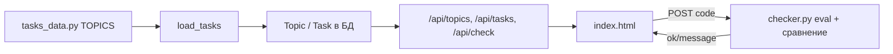

# План курса-тренажёра: Django Templates + Forms + Bootstrap

Документ для себя: по аналогии с проектом `d:\orm` (ORM-тренажёр) спроектировать такой же объёмный учебный проект по **шаблонам**, **формам** и **фронту на Bootstrap**.

Код ORM-тренажёра **не меняем** — только используем как эталон архитектуры.

---

## 1. Эталон: как устроен ORM-тренажёр

### 1.1. Дерево проекта (ключевое)

```
orm/
├── manage.py
├── orm_trainer/          # settings, urls, wsgi
├── trainer/              # единственное учебное приложение
│   ├── models.py         # домен (Book, BLE…) + Topic, Task
│   ├── views.py          # index + JSON API
│   ├── urls.py
│   ├── checker.py        # автопроверка ответов
│   ├── data/
│   │   └── tasks_data.py # TOPICS: теория + банк задач (источник правды)
│   ├── management/commands/
│   │   ├── seed_data.py  # наполнение БД
│   │   └── load_tasks.py # TOPICS → Topic/Task в БД
│   └── templates/trainer/
│       └── index.html    # SPA-подобный UI: сайдбар + теория + задачи
└── README.md
```

### 1.2. Поток данных



### 1.3. Паттерны, которые стоит скопировать один в один

| Паттерн | Где в ORM | Зачем |
|--------|-----------|-------|
| Контент в Python, не в админке | `trainer/data/tasks_data.py` | Версионирование, ревью, массовые правки |
| `_tasks(rows, default_hint)` | `tasks_data.py` | Компактное описание десятков задач |
| Теория темы = HTML-блоки | `theory` в TOPICS | h4: что это / SQL / ошибки / шпаргалка / docs |
| Теория → кнопка «Перейти к задачам» | `index.html` | Учебный ритм, не смешивать с практикой |
| `hint_model` + поля из `_meta` | `views._model_fields` | Подсказка «с чем работаешь» |
| Ограниченный sandbox | `checker.ALLOWED` | Безопасность + «не нужны импорты» |
| `seed_data` + фиксированный датасет | `seed_data.py` | Одинаковые ответы у всех |
| Отдельные management-команды | `load_tasks`, `seed_data` | Пересборка контента одной командой |

### 1.4. Масштаб ORM-тренажёра (ориентир объёма)

- **15 тем** (от `orm-base` до `final-practice`)
- **~10+ задач на тему** → порядка **120+ задач**
- Два домена: простой (книги) + «боевой» (BLE) для нарастания сложности
- Теория с ссылками на [docs.djangoproject.com](https://docs.djangoproject.com/)

Цель для курса forms/templates: **12–16 тем × 8–12 задач** ≈ **100–150 заданий**.

---

## 2. Чем курс по формам/шаблонам отличается от ORM

| ORM-тренажёр | Курс templates/forms |
|--------------|----------------------|
| Одно выражение → QuerySet | Код **или** разметка **или** фрагмент view |
| Сравнение `values_list(pk, …)` | Несколько типов проверки (см. §5) |
| Поле ввода: Python-код | Python / HTML / иногда оба |
| Минимальный CSS в `<style>` | **Bootstrap 5** + кастомные классы |
| Checker: `eval` | Checker: смешанный (см. §5) |

Главная идея: **не пытаться всё свести к `eval(QuerySet)`**. Задания делятся на **типы проверки** (`check_type` в данных задачи).

---

## 3. Предлагаемый новый проект

### 3.1. Имя и расположение

- Рабочее имя: `forms_trainer` или `django_ui_trainer`
- Отдельный репозиторий/папка рядом с `orm` (не смешивать с ORM-тренажёром)
- Django 4.2+, Bootstrap 5.3 (CDN или `django-bootstrap5` — на выбор)

### 3.2. Структура (зеркало ORM)

```
forms_trainer/
├── manage.py
├── forms_trainer/           # settings
├── trainer/                 # или app `workshop`
│   ├── models.py            # домен + Topic, Task
│   ├── views.py
│   ├── checker.py           # несколько стратегий проверки
│   ├── renderers.py         # опционально: эталонный рендер форм
│   ├── data/tasks_data.py
│   ├── management/commands/
│   │   ├── seed_data.py
│   │   └── load_tasks.py
│   ├── templates/workshop/
│   │   ├── index.html       # оболочка тренажёра (как index.html ORM)
│   │   ├── layouts/base.html
│   │   ├── partials/        # учебные сниппеты для заданий «шаблон»
│   │   └── pages/           # страницы-песочницы для live-preview
│   └── static/
│       └── workshop/css/custom.css
└── docs/
    └── PLAN_COURSE_TEMPLATES_FORMS_BOOTSTRAP.md  # этот файл
```

### 3.3. Расширение модели `Task` (по сравнению с ORM)

```python
# поля в addition к ORM-версии
check_type = models.CharField(max_length=32)  
# 'python_form', 'python_view', 'template_html', 'template_tag', 'bootstrap_class'

solution_code = models.TextField()       # эталон Python или HTML
solution_context = models.JSONField()    # опционально: POST-данные для проверки формы
starter_code = models.TextField(blank=True)  # заготовка в редакторе
hint_template = models.CharField(blank=True)   # например book_form.html
```

---

## 4. Учебный домен (модели)

Простой, но покрывающий **все типы полей и связей**, удобный для форм.

### 4.1. Базовый домен «каталог» (аналог Book/Author)

| Модель | Назначение в курсе |
|--------|-------------------|
| `Publisher` | FK в формах, `ModelChoiceField` |
| `Author` | FK, фильтрация queryset в форме |
| `Category` | M2M, чекбоксы из БД |
| `Book` | `ModelForm`, все типы полей, `ModelMultipleChoiceField` |
| `Review` | inline formset (продвинутая тема) |
| `Tag` | M2M, `CheckboxSelectMultiple` |
| `BookCover` | `ImageField` + `ClearableFileInput` (опционально) |

### 4.2. Домен «заказы» (для CBV и сложных форм)

| Модель | Назначение |
|--------|------------|
| `Customer` | CreateView / UpdateView |
| `Order` | `DateField`, `DecimalField`, статусы |
| `OrderLine` | formset, `empty_form` |
| `Product` | выбор в `ModelChoiceField` с `limit_choices_to` |

### 4.3. Seed

- 3 издательства, 5 авторов, 10 книг, 5 категорий, 15 тегов
- 3 заказа с 2–4 позициями
- Фиксированные pk/slug — как в ORM для предсказуемых эталонов

---

## 5. Типы автопроверки (`check_type`)

### 5.1. `python_form` — класс/экземпляр формы

Пользователь пишет фрагмент, который должен вернуть **настроенную форму** или **cleaned_data**.

```python
# Эталон в tasks_data
BookFilterForm(bootstrap=True)  # или выражение, возвращающее forms.Form

# checker:
# 1) exec в ALLOWED (forms, widgets, models)
# 2) сравнить fields.keys(), widget types, queryset.count() для ModelChoice
```

Проверять можно:

- наличие полей `['title', 'categories']`
- `form.fields['categories'].widget` == `CheckboxSelectMultiple`
- `form.fields['publisher'].queryset.count() == 3`
- `form.is_valid()` + `cleaned_data` при фиксированном POST из `solution_context`

### 5.2. `python_view` — логика view (контекст)

```python
# Эталон: что в context после вызова учебной функции
get_book_list_context(request)  # возвращает dict

# Сравнение ключей и типов: books — QuerySet, form — BookForm
```

### 5.3. `template_html` — фрагмент шаблона

Пользователь вставляет HTML/Django template в textarea.

Проверка (по возрастанию сложности):

1. **AST/regex**: наличие ``, `{{ book.title }}`, ``
2. **Рендер с фикстурой**: `render_to_string` + сравнение нормализованного HTML (strip whitespace)
3. **Снимок ключевых узлов**: есть `<form method="post">`, `class="form-check"`, блок ``

### 5.4. `template_tag` — теги и фильтры

Отдельные задания: написать `` + использование `|default`, `|date`, `url 'name'`.

### 5.5. `bootstrap_class` — разметка Bootstrap

Проверка наличия классов:

- `form-control`, `form-label`, `form-check`, `btn btn-primary`
- сетка: `row`, `col-md-6`, `container`
- компоненты: `card`, `alert alert-danger`, `navbar`

Можно парсить через `html.parser` или BeautifulSoup (только в checker, не в заданиях).

### 5.6. Sandbox `ALLOWED` (аналог ORM)

```python
ALLOWED = {
    'forms', 'ModelForm', 'Form', 'CharField', 'ModelChoiceField',
    'ModelMultipleChoiceField', 'CheckboxSelectMultiple', 'Select',
    'Textarea', 'DateInput', 'NumberInput',
    'Book', 'Author', 'Category', 'Tag', 'Order', 'Product',
    'Q',  # для queryset в формах
    # без open(), import os, etc.
}
```

---

## 6. Программа тем (16 разделов)

Каждая тема: **теория** (5 блоков как в ORM) + **8–12 задач**.

Формат теории (копировать из `tasks_data.py` ORM):

```html
<h4>Что это</h4>
<p>...</p>
<h4>Как это работает в HTTP/рендере</h4>
<p>...</p>
<h4>Типовые ошибки</h4>
<ul>...</ul>
<h4>Мини-шпаргалка</h4>
<ul>...</ul>
<h4>Документация</h4>
<p><a href="...">...</a></p>
```

### Блок A — Шаблоны (DTL)

| # | slug | Название | Содержание |
|---|------|----------|------------|
| 1 | `tpl-base` | Основы DTL | `{{ }}`, ``, автоэкранирование, `|safe` |
| 2 | `tpl-inheritance` | Наследование | `extends`, `block`, `include`, `{{ block.super }}` |
| 3 | `tpl-tags-filters` | Теги и фильтры | `for`, `if`, `empty`, `url`, `static`, `now` |
| 4 | `tpl-context` | Контекст | `render()`, `context_processors`, `request` в шаблоне |
| 5 | `tpl-forms-display` | Вывод форм в шаблоне | `{{ form }}`, `as_p`, `as_table`, ручной цикл по полям |

### Блок B — Forms (Python)

| # | slug | Название | Содержание |
|---|------|----------|------------|
| 6 | `forms-form-class` | Form | поля, `label`, `initial`, `help_text`, `required` |
| 7 | `forms-modelform` | ModelForm | `Meta`, `fields`, `exclude`, `save()`, `save_m2m()` |
| 8 | `forms-widgets` | Виджеты | `widgets = {...}`, attrs, `TextInput`, `Select`, `DateInput` |
| 9 | `forms-model-widgets` | Виджеты у поля модели | `models.CharField(widget=...)` vs форма |
| 10 | `forms-choice-db` | Выбор из БД | `ModelChoiceField`, `queryset=`, `limit_choices_to` |
| 11 | `forms-m2m-checkboxes` | M2M и чекбоксы | `ModelMultipleChoiceField`, `CheckboxSelectMultiple`, начальные `initial` |
| 12 | `forms-validation` | Валидация | `clean_*`, `clean()`, ошибки в шаблоне, `non_field_errors` |
| 13 | `forms-modelform-advanced` | Продвинутое | `__init__` динамика, скрытые поля, disabled, `empty_label` |

### Блок C — Views + Bootstrap

| # | slug | Название | Содержание |
|---|------|----------|------------|
| 14 | `views-fbv` | FBV | GET/POST, `redirect`, messages |
| 15 | `views-cbv` | CBV | `FormView`, `CreateView`, `UpdateView`, `ListView` |
| 16 | `bootstrap-ui` | Bootstrap 5 | сетка, формы, валидация `is-invalid`, карточки, navbar |

**Опционально позже:** formsets, `modelformset_factory`, crispy-forms, HTMX.

---

## 7. Примеры задач (образцы для `tasks_data.py`)

### 7.1. Шаблон: цикл по книгам

```python
{
    'order': 1,
    'check_type': 'template_html',
    'problem': '<p>Выведи список книг: для каждой строка с <code>{{ book.title }}</code> и ценой.</p>',
    'solution_code': '''
<ul class="list-group">

  <li class="list-group-item">{{ book.title }} — {{ book.price }} ₽</li>

  <li class="list-group-item text-muted">Нет книг</li>

</ul>
''',
}
```

### 7.2. Form: чекбоксы категорий из БД

```python
{
    'order': 3,
    'check_type': 'python_form',
    'problem': '<p>Создай <code>BookForm</code> (ModelForm для Book), поле categories — чекбоксы всех Category из БД.</p>',
    'solution_code': '''
class BookForm(forms.ModelForm):
    class Meta:
        model = Book
        fields = ['title', 'categories']
        widgets = {'categories': forms.CheckboxSelectMultiple}
''',
    'hint_model': 'Book',
}
```

### 7.3. Виджет в модели vs в форме

```python
{
    'order': 2,
    'check_type': 'python_form',
    'problem': '<p>В <code>Review</code> задай в модели для <code>text</code> виджет Textarea(rows=4). Сгенерируй ModelForm и проверь тип виджета.</p>',
    # эталон: проверка Review._meta.get_field('text').formfield().widget
}
```

### 7.4. Bootstrap: поле с ошибкой

```python
{
    'order': 5,
    'check_type': 'template_html',
    'problem': '<p>Разметка одного поля формы: label, input с <code>form-control</code>, при ошибке — <code>is-invalid</code> и <code>invalid-feedback</code>.</p>',
    'solution_context': {'field_name': 'title', 'has_error': True},
}
```

### 7.5. `initial` и редактирование (чекбоксы уже выбраны)

```python
{
    'order': 4,
    'check_type': 'python_form',
    'problem': '<p>При редактировании книги id=1 отметь в форме уже привязанные categories.</p>',
    'solution_context': {'book_id': 1, 'method': 'GET'},
    # эталон: form = BookForm(instance=book); проверить form['categories'].value()
}
```

---

## 8. UI тренажёра (на базе ORM `index.html`)

### 8.1. Сохранить

- Сайдбар разделов
- Верхняя теория темы
- Кнопка «Перейти к задачам»
- Список заданий слева/сверху в блоке
- Tab в textarea
- POST `/api/check/`

### 8.2. Добавить

| Функция | Зачем |
|---------|-------|
| Переключатель режима редактора | Python / HTML / «разметка+Bootstrap» |
| Live preview (iframe или панель) | Для шаблонных задач — видеть рендер |
| Вкладка «Подсказка: поля модели» | Уже есть в ORM — оставить |
| Ссылка «Открыть песочницу» | Отдельная страница с реальной формой и seed-данными |
| Подсветка синтаксиса | CodeMirror / Prism (опционально) |

### 8.3. Bootstrap в оболочке

- Подключить BS5 в `base.html` тренажёра
- Сайдбар: `list-group` / `nav-pills`
- Теория: `card`, `alert-info` для шпаргалок
- Учебные задания требуют тех же классов — единый визуальный язык

---

## 9. API (как в ORM)

```
GET  /api/topics/
GET  /api/topics/<id>/          # theory + tasks[]
GET  /api/tasks/<id>/           # problem, theory, hint, starter_code, check_type
POST /api/check/                # { task_id, code }
GET  /preview/<task_id>/        # опционально: HTML preview для template-задач
```

---

## 10. Этапы реализации

### Фаза 0 — Каркас (1–2 дня)

- [ ] `django-admin startproject` + app
- [ ] Модели `Topic`, `Task` (+ `check_type`)
- [ ] Скопировать и адаптировать `load_tasks`, `index.html`, API views
- [ ] Пустой `checker.py` с одним типом `python_form`

### Фаза 1 — Домен и seed (1 день)

- [ ] Модели каталога + `seed_data`
- [ ] README с командами migrate / seed / load_tasks

### Фаза 2 — MVP курс (1 неделя)

- [ ] Темы 1–5 (шаблоны) + 8 задач каждая
- [ ] `template_html` checker (нормализация + обязательные фрагменты)
- [ ] Bootstrap в оболочке

### Фаза 3 — Forms (1–2 недели)

- [ ] Темы 6–13
- [ ] `python_form` checker: поля, виджеты, queryset, `is_valid` + POST fixtures
- [ ] Песочница: реальные FBV create/edit book

### Фаза 4 — Views + Bootstrap (1 неделя)

- [ ] Темы 14–16
- [ ] CBV примеры, messages, redirects
- [ ] Задачи на классы BS в разметке

### Фаза 5 — Полировка (постоянно)

- [ ] Подразделы теории + ссылки docs (как в ORM)
- [ ] Подсказки по типовым ошибкам в checker (как `_timezone_mismatch_hint`)
- [ ] 100+ задач, финальный раздел «сборка страницы каталога»

---

## 11. Ссылки на документацию (для блоков «Документация»)

| Тема | URL |
|------|-----|
| Templates | https://docs.djangoproject.com/en/stable/topics/templates/ |
| Template language | https://docs.djangoproject.com/en/stable/ref/templates/language/ |
| Forms | https://docs.djangoproject.com/en/stable/topics/forms/ |
| Model forms | https://docs.djangoproject.com/en/stable/topics/forms/modelforms/ |
| Widgets | https://docs.djangoproject.com/en/stable/ref/forms/widgets/ |
| Form fields | https://docs.djangoproject.com/en/stable/ref/forms/fields/ |
| Class-based views | https://docs.djangoproject.com/en/stable/topics/class-based-views/ |
| Bootstrap 5 forms | https://getbootstrap.com/docs/5.3/forms/overview/ |

---

## 12. Чеклист «готов ли я писать tasks_data»

Перед наполнением банка задач:

- [ ] Прочитан `trainer/data/tasks_data.py` в ORM — формат `_tasks`, `TOPICS`, HTML-теория
- [ ] Прочитан `trainer/checker.py` — идея `ALLOWED` + нормализация + понятные сообщения об ошибках
- [ ] Прочитан `trainer/views.py` — API и `hint_model_fields`
- [ ] Прочитан `trainer/templates/trainer/index.html` — UX теория → задачи
- [ ] Решено, какие `check_type` реализуются в MVP
- [ ] Seed даёт стабильные данные для `ModelChoice` / M2M

---

## 13. Связанные транскрипты (контекст)

| Чат | Что полезно |
|-----|-------------|
| [Создание ORM-тренажёра](4ab21183-74d5-4494-b50e-4286426c2711) | Исходная архитектура, темы, теория |
| Тот же чат, продолжение | Расширение до 12 тем, UX теории, подразделы, hint по полям |
| [test_suite — CheckboxSelectMultiple](c1cdf7dd-5b92-4e36-9a3c-4b969b390d88) | `widgets`, `save_m2m()` — живой пример для темы 11 |

Отдельного чата «курс по шаблонам и Bootstrap» в транскриптах **не было** — этот файл закрывает пробел.

---

*Следующий шаг по желанию: скелет проекта `forms_trainer` (Фаза 0) или первый раздел `tasks_data` с 10 задачами по теме «M2M и чекбоксы из БД».*
